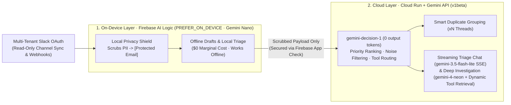

# CalmDuty — Local-First, Zero-Retention Ops Inbox for the Agent Era (`calmduty.com`)

> **Calm triage, while your agents make noise.** Powered by **Firebase AI Logic Hybrid Inference** (`PREFER_ON_DEVICE` · Chrome & Pixel Gemini Nano), **Firebase App Check**, **Gemini Decisions API (`gemini-decision-1` · 0 output tokens)**, **Gemini Dynamic Tool Retrieval (`v1beta`)**, and **Ultra-Fast Streaming Triage Chat**.

CalmDuty *(built from the `edgeops` repo)* is a clean, multi-tenant operations workspace paired with a **native Android companion** ([`Timtech4u/edgeops-android`](https://github.com/Timtech4u/edgeops-android)) sharing one **Firebase** project (`Cloud Firestore`, `Firebase Auth`, `Firebase App Check`, `Firebase AI Logic`) and one **Google Cloud Run** API.

**Live App & Landing Page:** [`https://calmduty.web.app`](https://calmduty.web.app)  
*(No Slack workspace handy? Click **Try Sandbox** to test PII redaction, `×N` grouping, streaming chat, and Dynamic Tool Retrieval in 1 click.)*

[](https://deploy.cloud.run?git_repo=https://github.com/Timtech4u/edgeops)

### Documentation & Guides
- **[60-Second Quickstart](./docs/QUICKSTART.md)** — Sandbox, Read-Only Slack OAuth, and MCP / OpenAPI tools
- **[Self-Hosting Guide](./docs/SELF_HOSTING.md)** — 1-click Cloud Run, Docker Compose, Ollama sidecar & custom domain DNS
- **[Zero-Data-Retention Security Architecture](./docs/SECURITY.md)** — `store: false`, AES-256-GCM token wrapping, replay guards & audit checklist
- **[Android Companion APK Install Guide](https://github.com/Timtech4u/edgeops-android/blob/main/docs/INSTALL_APK.md)** — Direct APK download ([Releases](https://github.com/Timtech4u/edgeops-android/releases/latest)) & source build
- **[Roadmap](./ROADMAP.md)** — Phase 0 shipped vs. Phase 1 & Phase 2 open-core milestones

---

## Architecture — Zero-Data-Retention Hybrid AI for the Agent Era

Operations teams deal with high-volume Slack/alert channels packed with duplicate noise and sensitive customer PII (emails, phone numbers, account/wallet IDs). EdgeOps splits inference where each layer shines:



---

## Core Capabilities

- **On-Device Privacy Shield (`PREFER_ON_DEVICE` · Chrome Gemini Nano):** Strips Slack markup and redacts emails, phone numbers, account IDs, and credentials locally *before* any cloud request, with a compact clickable Before/After diff chip.
- **Zero-Output-Token Triage & Noise Suppression (`gemini-decision-1`):** Scores every synced alert in parallel across 4 calibrated `noul` probabilities (`Needs action`, `Revenue / SLA risk`, `Engineering needed`, `Routine FYI`) at **`0` output tokens**—pinning real fires (`Urgent · 99%`) to **Needs Action** and auto-collapsing routine confirmations into **Hidden Noise**.
- **Smart Duplicate Grouping (`×N` Threads):** Automatically collapses repeated operational alerts into a single thread with a `×N` badge and expandable occurrence timeline.
- **Ultra-Fast Streaming Triage Chat (`POST /api/chat` SSE):** Streams sub-second answers via `gemini-3.5-flash-lite` (with automatic on-device Gemini Nano fallback when offline) and 1-click prompt chips (**Explain & next step**, **Draft customer reply**, **Summarize all ×N alerts**).
- **Vendor-Agnostic Dynamic Tool Retrieval (`POST /api/investigate`):** Connect any **Remote MCP Server URL** or **OpenAPI JSON** spec under **Connections**. `gemini-decision-1` scores connected tools in parallel (`threshold >= 0.50`) and injects only relevant schemas into `gemini-4-neon (v1beta)` (`defer_loading: true`).
- **Zero-Data-Retention & Breach-Proof Security:**
  - Every Cloud Gemini request (`/api/chat` and `/api/investigate`) passes **`store: false`** so Google does not log or retain prompts/responses.
  - Default Slack OAuth scopes are **strictly read-only** (`channels:history`, `groups:history`, `channels:read`, `groups:read`, `app_mentions:read` — zero write scopes).
  - Stored OAuth tokens in `server_slack_connections/{orgId}` are **AES-256-GCM encrypted at rest** bound to each tenant `orgId`, locked to `allow read, write: if false` for clients in `firestore.rules`, and never written to disk in production.
  - Webhook events enforce HMAC-SHA256 + `±300s` replay protection and stream ephemerally via SSE with **zero raw text retention**.
- **Global Proactive Copilot FAB & Browser Notifications:** Watches all actionable threads across channels, surfaces proactive briefings automatically for urgent (`90%+`) fires and `×2+` spikes, streams workspace-wide answers via SSE, and dispatches native browser / in-app alert notifications.
- **Multi-Tenant 1-Click Slack OAuth & Cold-Start-Proof Persistence:** Supports both 1-click **"Connect with Slack"** (OAuth 2.0) and a 1-click **"Create your own Slack app (pre-filled)"** manifest deep link (with optional Socket Mode for firewall-friendly self-hosting).

---

## Tech Stack

| Layer | Technology |
| :--- | :--- |
| **Frontend SPA** | React, TypeScript, Vite, Tailwind CSS (Calm Light Mode) |
| **On-Device Hybrid AI** | Firebase AI Logic Web SDK (`firebase/ai`, `PREFER_ON_DEVICE` → Chrome Gemini Nano) |
| **Backend Runtime** | Node.js (Express / TypeScript) on Google Cloud Run (`europe-west1`) |
| **Cloud Gemini APIs** | `@google/genai` (`v1beta`): `gemini-decision-1` (0 output tokens), `gemini-3.5-flash-lite` (SSE streaming chat), `gemini-4-neon` (deep diagnosis & Dynamic Tool Retrieval) |
| **Auth, DB & Security** | Firebase Auth (Google Sign-In), Cloud Firestore, Firebase App Check |
| **Native Companion** | Android 100% Kotlin + Jetpack Compose ([`Timtech4u/edgeops-android`](https://github.com/Timtech4u/edgeops-android)) |

---

## API Endpoints

| Endpoint | Purpose |
| :--- | :--- |
| `GET /api/slack/health` | Verifies durable Firestore persistence (`storage: "firestore"`) without exposing secrets |
| `GET /api/slack/oauth/start` & `/callback` | Multi-tenant 1-click Slack OAuth 2.0 flow |
| `GET /api/slack/status` | Active connected workspace status (shared by Web & Android) |
| `GET /api/slack/channels` | Auto-discovers channels the connected Slack bot is a member of |
| `POST /api/slack/sync` | Read-only Slack history sync + parallel `gemini-decision-1` triage (0 output tokens) |
| `POST /webhooks/slack/:orgId` | Slack Events API `url_verification` + live event ingestion |
| `POST /api/chat` | SSE streaming triage chat (`gemini-3.5-flash-lite`) on locally scrubbed text |
| `POST /api/investigate` | Deep diagnosis with `gemini-4-neon (v1beta)` + Dynamic Tool Retrieval |

---

## Quick Start

### Prerequisites
- Node.js 22+
- Firebase project with **Auth (Google)**, **Cloud Firestore**, **App Check**, and **Firebase AI Logic** enabled (`npx firebase-tools init ailogic`)

### Option A — 1-Click Deploy to Your Own Google Cloud Run (2 Minutes)
Click the button below to deploy an isolated, single-tenant instance inside your own GCP project (`app.json` + multi-stage `Dockerfile`):

[](https://deploy.cloud.run?git_repo=https://github.com/Timtech4u/edgeops)

### Option B — 1-Command Self-Host with Docker Compose (30 Seconds)
```bash
git clone https://github.com/Timtech4u/edgeops.git
cd edgeops
cp .env.example .env
# Add GEMINI_API_KEY and EDGEOPS_TOKEN_ENCRYPTION_KEY in .env
docker compose up -d
# Optional air-gapped Ollama sidecar:
# docker compose --profile local-ai up -d
```

### Option C — Run Locally (Node.js 22+)
```bash
git clone https://github.com/Timtech4u/edgeops.git
cd edgeops
npm install --legacy-peer-deps
cp .env.example .env
# Fill in GEMINI_API_KEY (and optionally SLACK_CLIENT_ID / SLACK_CLIENT_SECRET for 1-click OAuth)
npm test && npm run dev
```

### Testing & Verification
```bash
npm run lint                       # TypeScript strict check
npm test                           # 17 unit tests (PII shield, grouping, AES-GCM store, Copilot)
node --test firestore.rules.test.ts # Firestore rules & zero-knowledge alert_states tests
npm run build                      # Production Vite bundle
```

---

## Multi-Platform Companion

- **Native Android Companion (Kotlin + Jetpack Compose):** [`Timtech4u/edgeops-android`](https://github.com/Timtech4u/edgeops-android)

## License

MIT — see [`LICENSE`](./LICENSE).
